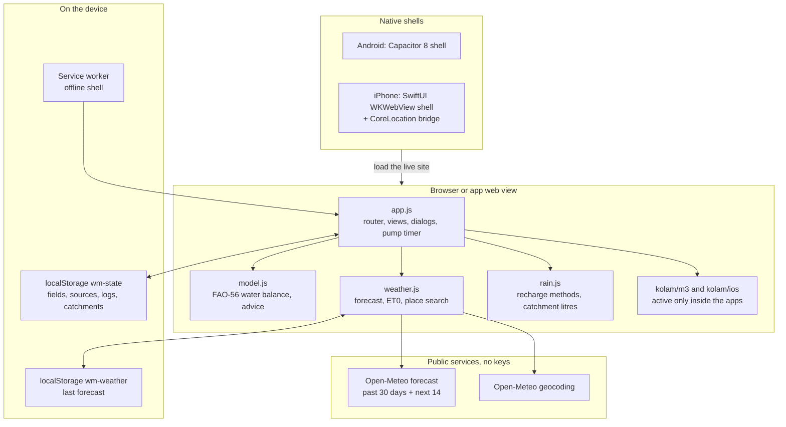
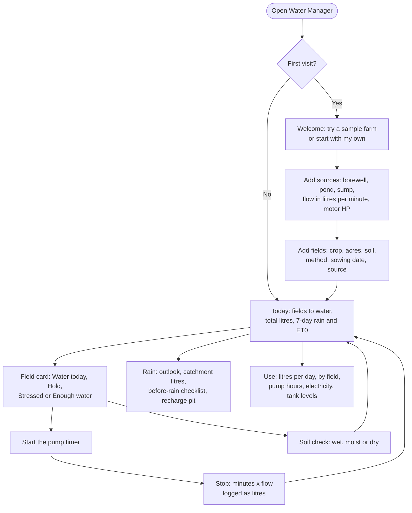
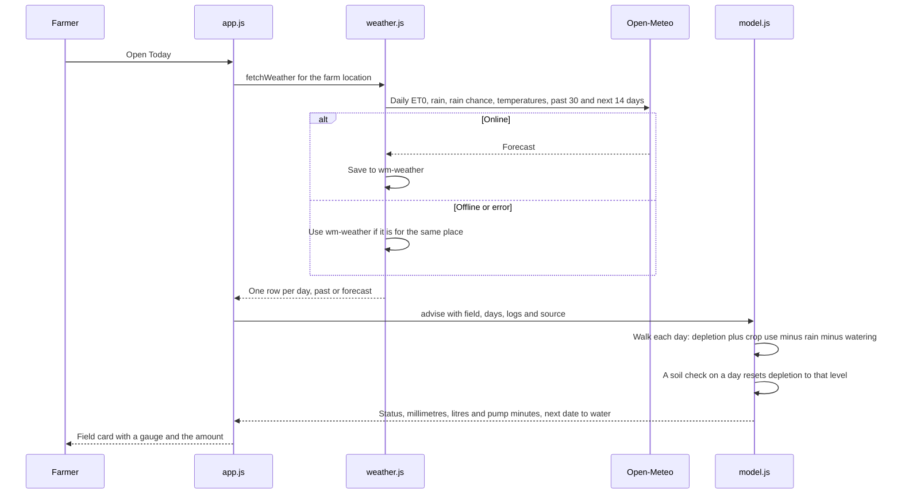
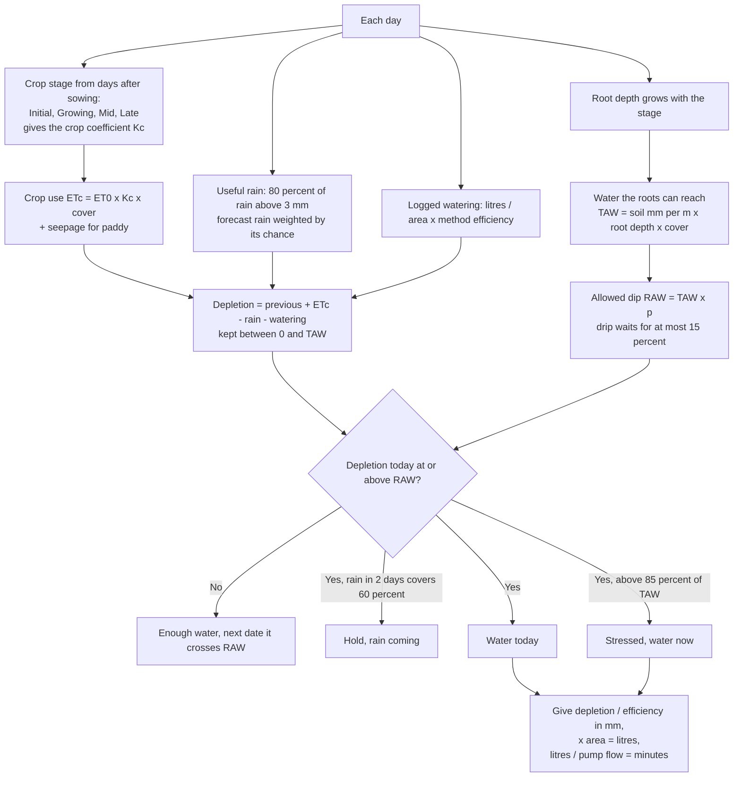
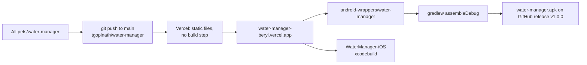

# Water Manager

Water Manager is a farm irrigation planner for Indian farms with a borewell, a pond or a sump. Each morning it says which field to water, how many litres, and how long to run the pump, from live weather. A second part, Rain, explains how to recharge a borewell and every practical way to catch, store and use rainwater, with litres worked out from the farm's own roofs and land. The engineering idea is a real agronomy model in the browser: a daily FAO-56 soil water balance per field, driven by Open-Meteo's reference evapotranspiration (ET0) and rain for the last 30 days and the next 14, and corrected whenever the farmer logs a watering or a soil check. Everything stays on the device.

| Platforms | Stack | Data | Hosting |
|---|---|---|---|
| Web PWA, Android app (Capacitor shell), iPhone app (SwiftUI shell with native location) | Plain HTML, CSS and ES modules; Kolam design system with the M3 and iOS kits bundled | Open-Meteo forecast, ET0 and geocoding; the farm's fields, sources and logs in localStorage | Vercel (water-manager-beryl.vercel.app), APK on GitHub Releases |

## System architecture

`index.html` loads `app.js` as an ES module, which imports four small modules: `model.js` (crops, soils, methods and the water balance), `weather.js` (Open-Meteo), `rain.js` (rainwater methods and catchment maths) and `store.js` (the saved farm). The Kolam M3 and iOS kits are copied into `kolam/` so the apps work offline. There is no server code and no account.

*Static site on Vercel. Export and Import in the Fields view write and read the whole farm as one JSON file, which is the only backup.*

## Main user flow

*The pump timer is stored in state, so it keeps running through a reload or a closed tab.*

## Data flow and state

### Today's advice for one field

### The water balance in `model.js`

For each field the model starts at full soil (depletion zero) on the sowing date, or 30 days back for established crops, and walks one day at a time.

*Model data: 19 crops with FAO-56 style Kc values, stage lengths, root depths and depletion fractions; 4 soils (sandy 70, red loam 120, loam 150, black cotton 190 mm of available water per metre); 4 methods (drip 0.9, sprinkler 0.75, furrow 0.6, flood 0.55 efficiency). Electricity is estimated as HP x 0.746 kW x hours.*

### Where state lives

| Store | Key or name | What it holds |
|---|---|---|
| localStorage | `wm-state` | Location (default Coimbatore), fields, water sources, logs (waterings and soil checks), catchments, the running pump, annual rain, whether the welcome was seen |
| localStorage | `wm-weather` | The last Open-Meteo reply with its place and time |
| Cache Storage | `wm-v7-ios` | App files, the bundled Kolam kits and Google Fonts |
| JSON file | `water-manager-<date>.json` | Export and Import of the whole state |

## Key modules

| File / module | Responsibility |
|---|---|
| `index.html` | Header, four tabs (Today, Fields, Rain, Use), the view and one dialog; loads the bundled Kolam kits |
| `app.js` | About 720 lines: router, welcome, Today, Fields, field detail with a soil-water chart, Rain with a recharge pit diagram, Use, all dialogs, pump timer, export and import, Android and iOS app modes |
| `model.js` | Crops, soils, methods, source kinds, crop stages, `balance` and `advise`, pump energy |
| `weather.js` | Forecast with `past_days=30` and `forecast_days=14`, cached copy, place search, weather codes and icons, expected rain |
| `rain.js` | Runoff coefficients for 6 surfaces, catchment litres (area x rain x runoff), rain outlook, the before-rain checklist, 9 methods in three groups (recharge the borewell, store it, slow it down on the land), and 7 uses of stored rain |
| `store.js` | Load, save and replace `wm-state`; the sample farm (4 fields, 3 sources, logs and catchments) |
| `sw.js` | Offline shell: cache first with a background refresh |
| `tools/shots.mjs` | Portfolio screenshots |

## Platforms

### Web and PWA

Built on Kolam tokens (Lato, JetBrains Mono for figures) in Water Manager blue `#0077B6`, with light and dark theme colours. It installs from `manifest.webmanifest` and opens on Today.

### Android app

A Capacitor 8 remote shell in `android-wrappers/water-manager` (app id `com.gopinath.watermanager`) that loads the live site, appends `WaterManager-Android` to the user agent and sets a matching background colour; `.keep-native` protects its hand-made parts. The Kolam M3 kit sets `html.k-android` and `app.js` builds the Material 3 app bar with a location action, a navigation bar (Today, Fields, Rain, Use) and Back from a field to Fields.

### iPhone app

A SwiftUI `WKWebView` shell in `WaterManager-iOS` (bundle id `com.gopinath.water-manager`) from the Kolam iOS template, plus `GeoBridge`: a small `navigator.geolocation` replacement injected at page start that asks `CLLocationManager` instead, so the farmer sees one iOS location prompt rather than a second web prompt. The Kolam iOS kit sets `html.k-ios`; `app.js` sets large titles on the tabs, Back plus a centred title on a field, and iOS styling for its dialogs and buttons. If both kits detect, iOS wins.

## Data sources and APIs

| Source | Used for | Licence / key |
|---|---|---|
| Open-Meteo forecast API | Daily ET0 (FAO evapotranspiration), rain, rain chance, temperatures, weather code; current conditions | Free, no key |
| Open-Meteo geocoding API | Finding the farm by place name | Free, no key |
| FAO-56 guide values | Crop coefficients, stage lengths, root depths and depletion fractions in `model.js` | Typical guide figures, as the code says; a soil check re-anchors the estimate |
| Hand-written guidance | Recharge methods, checklist and uses in `rain.js` | Written for this app |

## Offline, performance, privacy and accessibility

- **Offline:** the shell, including the Kolam kits, is cached on install; the last forecast is kept, so advice still shows offline and the place chip shows it is not live.
- **Speed:** five small modules, no framework, no build. The model walks at most about 44 days per field.
- **Privacy:** no account, no server storage, no analytics. The location goes only to Open-Meteo. The welcome screen says that data stays on the device.
- **Accessibility:** status pills pair a symbol with words (not colour alone), the 30-day bar chart has `role="img"` and a label, the view takes focus after each route change, and dialogs use the native `dialog` element.

## Build and deploy

*Both apps load the live site, so web changes reach them on the next open; the service worker picks up a new version in the background.*

## Known limits and next steps

- The Android shell's manifest declares only the internet permission. The web app's "Use my location" calls `navigator.geolocation`, which inside an Android web view normally needs a location permission, so that button may not work in the Android app (searching a place by name does). This has not been confirmed on a device.
- Crop and soil values are general guide figures, not calibrated for a district; the farmer's soil checks are what keep the estimate honest.
- All data lives in one browser; clearing site data loses the farm unless it was exported. There is no sync between phones.
- The interface is English only so far, although the audience is Tamil-speaking.
- No sensors: the model relies on weather and the farmer's logs.
- The APK is a debug build, installed by side-loading.

---

Written from the source code on 17 November 2026. Source: [github.com/tgopinath/water-manager](https://github.com/tgopinath/water-manager) (web app) and [github.com/tgopinath/WaterManager-iOS](https://github.com/tgopinath/WaterManager-iOS) (iPhone shell).
